# AION — AI Optimization Network

**Experimental AI-Assisted Compiler Optimization Research Platform**

A faster benchmark result is easy to obtain and difficult to trust. Compiler
changes can break correctness, move work outside the measured region, benefit
from a particular input, or appear faster because of measurement noise.

AION investigates these problems through small, bounded experiments on trusted
C++ workloads. It keeps output checks, raw measurements, uncertainty, failed
gates and independent confirmation alongside the result.

**Current version: AION 0.6 MVP Preview (`0.6.0.dev0`), an experimental pre-release.**
No independently verified optimization improvement has been discovered.
Native Linux scientific validation remains pending. This engineering milestone
does not complete Phase 6, validate WSL2 measurement quality or establish that a
candidate is universally faster.

## What works today

- Ten bundled C++ workloads, including multi-translation-unit applications.
- A trusted catalog of 31 MVP experiments; the original research command retains
  its separate 17-panel family.
- Reproducible offline deterministic ranking and optional import of genuine
  external LLM/coding-assistant proposals as strict JSON.
- Inspectable, sealed plans, explicit execution approval and command/time budgets.
- Real Clang builds, independent expected-output checks and separate differential,
  ASan and UBSan validation.
- Compute-region calibration, randomized interleaved paired measurements,
  uncertainty, quality gates and held-out confirmation with different seeds.
- Archived source/binary/profile provenance and JSON, Markdown and standalone
  local HTML reports. Failures, outliers and regressions remain visible.

```mermaid
flowchart LR
    A[Select trusted workload] --> B[Export bounded discovery context]
    B --> C[Deterministic ranking or external AI JSON]
    C --> D[Validate trusted IDs and freeze plan]
    D --> E[Inspect and approve]
    E --> F[Separate correctness and sanitizer checks]
    F --> G[Compile and calibrate]
    G --> H[Interleaved paired discovery]
    H --> I[Held-out confirmation]
    I --> J[Evidence and local report]
```



The deterministic strategy is a heuristic, **not an AI model**. Imported AI may
rank approved experiments and explain hypotheses. It cannot supply commands,
source paths, new recipes, LLVM passes or executable code. AION does not call a
model API or send source, credentials or context to a provider by default.
There is no automatic source rewriting or production preset promotion.

## Platform status

| Platform | Status |
|---|---|
| Ubuntu/Linux x86-64, including WSL2 | Primary locally tested execution environment; see the release validation record |
| Windows Python | Compatible CLI/planning/reporting and tests; compiler operations require a usable C++ SDK. Run the complete MVP in WSL2 |
| macOS Apple Silicon ARM64 / M4 | Compatibility implementation and native-only tests prepared; **real Mac verification pending** |
| GitHub-hosted Linux/Windows/macOS ARM64 | CI configured; **not executed from this local workspace** |

Capabilities are detected explicitly. macOS has no Linux CPU affinity,
`perf_event_open`, `/proc` or `/sys` diagnostics. Its memory protection uses a
documented resident-memory watchdog rather than a Linux address-space ceiling.
Optional unsupported diagnostics retain a reason. See the
[Apple Silicon guide](docs/install-macos-apple-silicon.md).

## Install from source

This preview has not been published to PyPI. Clone the actual repository URL
provided by its owner, then enter the checkout. The runtime requires Python
3.12+ and uses the Python standard library. Clang needs a C++17 library/linker;
matching LLVM profiling tools are required only for PGO recipes.

On Ubuntu 24.04 or inside Ubuntu on WSL2:

```bash
sudo apt-get update
sudo apt-get install clang llvm lld g++ python3-venv
python3 -m venv .venv-linux
source .venv-linux/bin/activate
python -m pip install -e '.[dev]'
aion doctor --json
```

Keep WSL and Windows environments separate. For Windows-compatible Python work:

```powershell
py -3.12 -m venv .venv
.venv\Scripts\python.exe -m pip install -e '.[dev]'
.venv\Scripts\python.exe -m pytest -q
```

On Apple Silicon, install Apple's Command Line Tools and Homebrew LLVM 18 using
the [complete M4 clone/install/test instructions](docs/install-macos-apple-silicon.md).
Use `brew --prefix` and the documented `AION_CXX` / `AION_LLVM_BIN` settings;
Apple Clang and upstream LLVM Clang are different toolchains.

## Run the local demonstration

From an activated Linux/WSL or supported macOS environment:

```bash
aion mvp list
aion mvp demo --workload records --strategy deterministic
```

The default bounded demo selects at most two candidates, validates them, performs
discovery and confirmation, then prints `report.json`, `report.md` and
`report.html` paths. Open the HTML file locally; it needs no network or scripts.
Completion means the engineering workflow ran, not that the quality gates passed.
When no optimization qualifies, the report says:

> No independently verified improvement found.

To review the plan before running:

```bash
aion mvp plan --workload records --output .aion/my-plan
aion mvp inspect --plan .aion/my-plan/plan.json
aion mvp run --plan .aion/my-plan/plan.json --approve
```

Use a fresh output directory for every attempt. No automatic retry or candidate
replacement occurs. See [MVP quickstart](docs/mvp-quickstart.md) for budgets,
schemas and report regeneration.

## Import external AI proposals

```bash
aion mvp context --workload array --output .aion/array-context.json
# Give only this bounded context to your external LLM/coding assistant.
# Save its actual response using the strict documented proposal schema.
aion mvp demo --workload array --strategy ai-import \
  --context .aion/array-context.json --proposals .aion/actual-response.json
```

Context includes approved IDs, budget and optional compatible discovery summaries
and diagnostics. Held-out confirmation is rejected as selection input. Reports
distinguish imported proposals, deterministic selection and explicit unavailable-
provider fallback. Malformed supplied proposals are rejected, never executed.
External model identity/authorship is caller-declared and cannot be authenticated
by AION. No external API or paid service is required.

## Interpreting results and limits

Working functionality and output correctness are distinct from a local
experimental performance signal. Quality-valid local comparisons are distinct
from scientifically confirmed improvements. A passing CI job tests software
compatibility, not benchmark stability or physical-host independence.

ASan/UBSan and finite independent cases do not prove equivalence for every input.
Process time/output/memory controls are **not a sandbox for arbitrary code**.
Only execute trusted workloads. Local reports can contain paths, host metadata
and process output; review/redact them before sharing.

The two original retained MVP demos passed 112/112 measured output checks and
90/90 separate validation checks, but found no independently verified gain. See
[actual demo results](docs/mvp-demo-results.md) and
[current release readiness](docs/release-readiness.md). Historical local artifacts
are preserved in ignored `.aion/` storage and are not bundled into a public clone;
links to those local artifacts in historical documents require the original data.

## Documentation and roadmap

- [MVP overview](docs/mvp-overview.md), [architecture](docs/mvp-architecture.md),
  [quickstart](docs/mvp-quickstart.md), [validation](docs/mvp-validation.md).
- [Release and publication procedure](docs/github-publication.md),
  [Apple Silicon installation](docs/install-macos-apple-silicon.md).
- [Phase 5 methodology](docs/phase5-methodology.md),
  [validation](docs/phase5-validation.md), [findings](docs/phase5-research-findings.md).
- [Earlier methodology](docs/reliable-benchmarking.md),
  [native Linux protocol](docs/phase5-native-instructions.md), [roadmap](ROADMAP.md).

The next compatibility step is real Apple M4 execution. Scientific readiness
still requires the separate native physical Linux control/confirmation protocol.
Future AI optimization research remains separate from this release preparation;
no new optimizer or AION 0.7 work is included.

Contributions are welcome under the existing [MIT license](LICENSE). Read
[CONTRIBUTING](CONTRIBUTING.md), [SECURITY](SECURITY.md),
[CODE_OF_CONDUCT](CODE_OF_CONDUCT.md) and [CHANGELOG](CHANGELOG.md).
