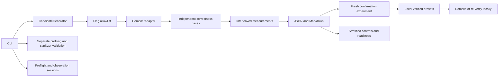

# Architecture

Release portability is documented in the [Apple Silicon guide](install-macos-apple-silicon.md).
OS capabilities are distinct from measurement readiness. macOS uses a sampled
resident-memory watchdog, POSIX termination/CPU/output protections and explicit
unsupported affinity/counter records; it does not claim Linux RLIMIT_AS or perf
support. Configurable compiler/LLVM paths preserve driver names and distinguish
Apple Clang from upstream LLVM. Actual native Mac verification remains pending.

The **0.6 MVP Preview** adds a user-facing proposal/plan/execution/report layer
over these existing components. It is not Phase 6 scientific qualification.
See [MVP architecture](mvp-architecture.md) for trusted-ID validation, discovery-only
AI context, parent budgets, explicit approval and experimental reporting. The
Phase 5 architecture below remains the underlying research machinery.

Phase 5 adds `research_catalog` (17 fixed panels and bundled source closures),
`research_reference` (independent distribution expectations), `research`
(declaration, adapter, attempts and confirmation), `budget` (scoped command/time
accounting), `research_diagnostics` and `native_report`. The research adapter
reuses Clang and the existing measurement engine. Its explicit reference can be
O3, LTO or PGO; reference overrides require this adapter and produce typed
`research-timing`, with preset promotion disabled. The normal engine retains O3.

Declarations preserve source snapshots and validate installed catalog, input and
toolchain identity. A ContextVar budget wraps logical bounded process calls;
normal workflows have no active research budget. A study journal exists before
compiler initialization, preserves partial failures and refuses silent retries.
Independent runs use separate sessions, scheduling and held-out inputs. Results
retain per-configuration actual variant/build identity and archived executable/
PGO bytes. Diagnostics use separate executions of hash-verified archives.

Research reports recompute existing comparisons/gates and compatibility using
read-only structural views; persisted evidence stays typed research. Registry
rejection checks both evidence kind and research markers. No candidate provider,
model call, automatic rewrite, evolutionary search or universal research preset
is introduced. Native reporting is separate from test success and observational
preflight, and checks source-linked controls, all-ten validation and independent
timings without pooling. See [Phase 5 methodology](phase5-methodology.md).

The compiler adapter, candidate generator, experiment runner, verification layer, and local registry have separate responsibilities. Candidate recipes pass the flag policy before compilation/execution, including probes and diagnostic investigations. The registry does not execute code.

## Compiler adapters

`CompilerAdapter` exposes compiler identity, `probe(candidate)`, and `compile(source, output, candidate)`. A source can be a single path or a sequence of translation units. `ClangAdapter` detects Clang, records its version/target, and probes real C++ linking and execution. It preserves the driver invocation name across symlinks: invoking `clang++` as `clang` would change automatic C++ library linking. Each compilation returns timing, executable size, source/binary hashes, and complete subprocess diagnostics, including failures. Build provenance records compiler/linker binary identity and C++ library identity. All commands are argument arrays and never shell strings.

A Rust, Go, or PHP adapter can implement the protocol, but should introduce a language-specific candidate policy and benchmark manifest rather than pass C++ flags through unchanged. Language-neutral source transformations and richer correctness contracts are future work.

## Experiments and independent verification

`run_experiment` probes fresh builds, checks all reference cases, and uses discarded bounded pilots to calibrate each configuration to 250–500 ms of compute time. It measures adjacent baseline/candidate pairs in balanced randomized order, with shuffled pair order. Pilots and warmups remain separate. The C++ protocol separates setup and computation and normalizes repeated batches to equal work. Every execution must match its reference.

`candidate_assessment` recomputes paired moving-block intervals from raw records. It checks pair IDs, completeness, calibration, correctness, CV, physical duration, drift, uncertainty, and unchanged improvement/regression floors. The registry requires fresh builds/calibration, different scheduling/bootstrap and input seeds, identical compiler/environment/limits/flags/fingerprints, and a common improved workload in both runs. PGO records separate training and profile provenance; application-specific profiles cannot become flag-only presets. See [Phase 2 methodology](reliable-benchmarking.md).

The deterministic generator implements `CandidateGenerator.generate(previous_results)`. A future AI research agent can implement that same interface. The runner must still validate proposals through its flag policy and independent experiment pipeline. The interface intentionally returns candidate data, not shell commands, URLs, executable plugins, or authorization to publish.

Phase 3 adds `controls` and `host` without replacing the measurement/statistics pipeline. The child applies and verifies optional Linux affinity before exec; current C++ workloads also report their actual PID and affinity snapshots. Read-only start/end host observations distinguish unavailable data and guest CPU placement from physical isolation. `reproducibility` requires compatible recorded identity, toolchain, sources, limits, and controls before independent confirmation; comparisons never pool samples. See [Phase 3 methodology](phase3-methodology.md).

`experiments` builds byte-identical A/A and known-slowdown controls, audits false-positive performance signals, and always rejects control presets. `investigation` preserves frozen-source disassembly, pre-link IR, remarks, and profile provenance before fresh independent measurements. The manifest's source/header lists and application reference dispatch support additional multi-file programs without a fixed suite-size limit. Failures preserve partial measurement evidence through the CLI callback.

## Process isolation and measurement

Phase 4 introduces typed `primary-timing`, `profiling`, `symbol-resolution`, `sanitizer-validation`, `measurement-quality`, `preflight` and `package-smoke` records. Diagnostic kinds are rejected by preset assessment. Host/boot sessions and observed scheduler/cgroup constraints extend compatibility while paired statistics remain unchanged. Control studies stratify designs and report descriptive uncertainty without pooling times. Native evidence availability, control quality, full native performance validation and local correctness readiness are separate assessments.

The trusted `helpers/perf_runner.cpp` counts a workload PID from exec to exit, or starts a separate user-cycle IP sampling execution. `profiling` retains availability, multiplexing, object/binary identity and unresolved addresses; symbol attribution requires sized function ranges. `validation` uses fixed sanitizer recipes outside timing and a separate input manifest. Its explicit shadow-address exception does not alter primary limits. Image and key/value applications use the existing multi-file manifest/oracle interface. See [Phase 4 methodology](phase4-methodology.md).

On POSIX, a separate Python supervisor forks and execs the workload, sets address-space, CPU time, output file size, and core dump limits in the child, then uses `wait4` for isolated child usage. This avoids cumulative `RUSAGE_CHILDREN` peak memory errors and excludes the supervisor's interpreter startup from measured wall time. Child process launch and limit setup are included. The parent enforces a wall timeout and kills the process group on timeout or output overflow. Compilation uses the same mechanism with separate bounds.

Windows uses direct subprocesses, wall timeouts, output caps, and process-tree termination. Peak RSS and CPU/address-space limits remain unavailable. Phase 2 compute clocks exclude startup on either platform; total wall time is retained separately. Linux remains primary. POSIX supervisor metadata is atomically published; interrupted or malformed metadata becomes a process failure.

These limits handle accidental runaway workloads, not hostile programs. The MVP runs trusted local, bundled C++ sources and explicit local compilation inputs. It has no network download or remote execution path. Process creation, syscalls, filesystem access, network access, and descendant counts are not sandboxed. Use an external sandbox for untrusted code. Interruptions clean up active process trees and temporary builds.

## Registry and compatibility

Presets contain only allowlisted flags plus local evidence and compatibility metadata. Names cannot escape the registry directory. Reuse checks exact compiler version/family/target, OS, machine architecture, CPU identity, required CPU features, and source/input fingerprints. There is intentionally no `-march=native` preset in Phase 1.

Evidence digests detect changes when compared with the local evidence files; they are not signatures or an authenticity guarantee. Local files remain under the user's control. A future public registry needs a canonical format, signatures, publisher trust, provenance, revocation, and independent verification before distribution. No remote fetching or automatic update mechanism exists here.
