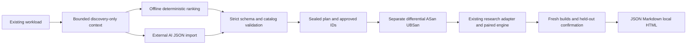

# MVP architecture

The [release portability layer](install-macos-apple-silicon.md) permits macOS MVP
execution with explicit OS capabilities, unpinned controls, supported process
protections and matching LLVM tools. It does not introduce a second measurement
algorithm or alter the catalog's 31-entry family. Actual Mac verification remains
pending, and research still cannot qualify scientific Phase 6 or create presets.

`mvp_catalog.py` contains only approved local panel definitions: the unchanged
17-panel research catalog plus fourteen standard O2/LTO contrasts using existing
sources. The executor resolves IDs to those definitions. No serialized recipe,
source path, model code, LLVM pass string or shell command becomes executable.
The preview's family has 31 comparisons; the original research workflow keeps
its original 17-panel family.

`mvp_context.py` exports only bounded catalog/workload/budget data, discovery
summaries and linked diagnostic counts. It rejects confirmation evidence before
selection and never exports raw source or process output. `mvp_proposals.py`
validates a closed JSON schema and implements the explicitly non-AI baseline.
Imported provenance is caller-declared and cannot authenticate a model or its
external information sources. There is no provider client or implicit network
request. Approved ID references are the execution boundary even if external text
is adversarial.

`mvp.py` creates a plan and input/rejection receipts, freezes selected IDs, binds
the research declaration to installed source/compiler identities and requires
explicit approval for separate execution. A demo invocation supplies that
bounded approval. The journal exists before compilation/validation begins.
Existing `ResearchAdapter`, `run_study`, `run_validation` and `run_experiment`
handle compilation, PGO, correctness, calibration and timing. The MVP does not
implement a parallel benchmarking algorithm.

The existing budget supports parent accounting: each nested discovery or
confirmation command also consumes the global execution budget, with the
strictest remaining timeout. Validation and initial compiler checks consume the
same total. Planning has a separate fixed 100-command / 120-second cap. Commands,
failures, wall usage and stage artifacts are preserved. Failed correctness stops
primary execution; failures never cause adaptive selection, silent retries or
replacement candidates.

Research checks the sealed declaration for each panel and verifies actual
variant source bytes before and after compilation. Exact primary outputs are
checked before measurement. Separate validation covers unique selected source
contracts, including original extended cases. Both roles use fresh builds and
PGO profiles. Their explicit sessions and scheduling/input seeds differ; automatic
sequential windows do not establish physical statistical independence.

`mvp_report.py` reuses existing pair/gate assessment and keeps per-role estimates
separate. It never ranks candidates from held-out data or combines incompatible
reference recipes into a winner. Functionality, correctness, local quality,
regressions, exploratory signals and scientific readiness are distinct. Reports
always retain native validation pending and Phase 6 unqualified. Research kinds
and markers remain rejected by the preset registry.

JSON schema version 1 is retained with additive `mvp-plan`, `mvp-run`,
`mvp-report`, `mvp-selection-context`, `mvp-proposals` and planning-receipt kinds.
The original measurement methodology remains version 4. Existing statistics,
promotion thresholds, original C++ workloads and Phase 1–5 records are preserved.
Standalone HTML escapes all dynamic text and uses a restrictive content policy,
with no scripts or external resources.
